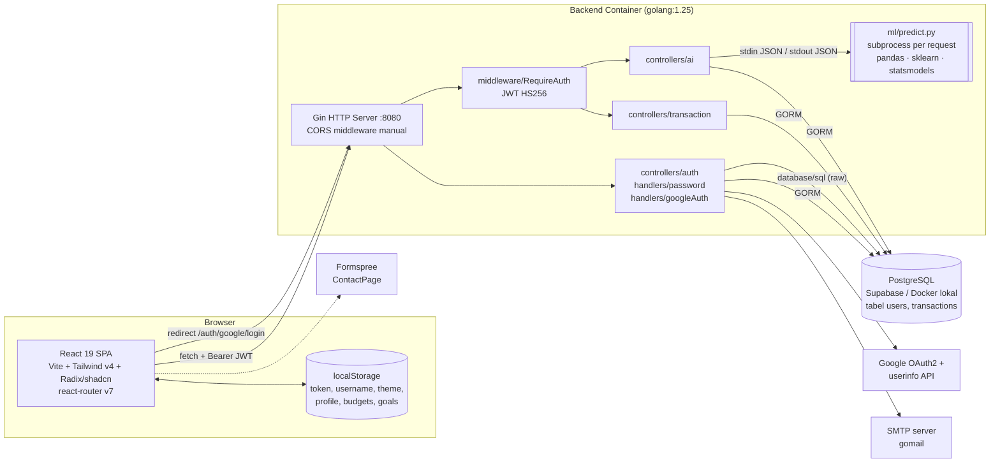

# Audit Report — DuitKuDW

> **Tanggal audit:** 11 Oktober 2026
> **Cakupan:** seluruh repository `D:\DUITKUDW` — backend Go (`src/backend`), ML Python (`src/backend/ml`), frontend React (`src/frontend`), konfigurasi Docker/infra, serta perubahan yang **belum di-commit** di working tree (refactor UI frontend).
> **Metode:** static review manual seluruh source file, `git diff` terhadap `HEAD`, `go vet ./...` (lulus, tanpa temuan), dan `npx eslint .` (gagal, 9 error). Aplikasi **tidak dijalankan** — temuan runtime disimpulkan dari pembacaan kode dan ditandai bila perlu diverifikasi.
> **Status kode:** tidak ada file yang diubah selama audit.
> **Basis audit:** commit `9787a54` + perubahan UI yang belum di-commit. Setelah audit ditemukan bahwa `origin/main` sudah maju 6 commit (`66b5ba1`…`150aeed`) yang memperbaiki sebagian temuan. Status terkini setiap temuan ada di [Bagian 0](#0-pelacak-status-temuan); detail perbaikan per fase ada di [`docs/`](./README.md).

---

## Daftar Isi

0. [Pelacak Status Temuan](#0-pelacak-status-temuan)
1. [Ringkasan Eksekutif](#1-ringkasan-eksekutif)
2. [Arsitektur Sistem](#2-arsitektur-sistem)
3. [Skala Prioritas](#3-skala-prioritas)
4. [Security Vulnerabilities](#4-security-vulnerabilities)
5. [Runtime & Logical Errors](#5-runtime--logical-errors)
6. [Code Smells (Clean Code)](#6-code-smells-clean-code)
7. [Inkonsistensi](#7-inkonsistensi)
8. [Rencana Perbaikan yang Disarankan](#8-rencana-perbaikan-yang-disarankan)
9. [Lampiran: Hasil Tooling](#9-lampiran-hasil-tooling)

---

## 0. Pelacak Status Temuan

Tabel ini diperbarui setiap kali satu fase selesai.

> **Status akhir (setelah Fase 3):** semua temuan berstatus ✅ kecuali dua tindakan manual 👤: **rotasi password DB lama (SEC-01)** dan **mengganti `JWT_SECRET` yang terlalu pendek (SEC-10)**. Rekomendasi arsitektur lanjutan ada di [fase-3-penyempurnaan.md](./fase-3-penyempurnaan.md#rekomendasi-arsitektur-belum-dikerjakan). Kolom **Ditutup oleh** merujuk ke commit/fase yang menyelesaikan temuan.

**Legenda:** ✅ selesai · 🟡 sebagian (sisa pekerjaan dijelaskan) · ⏳ belum · 👤 butuh tindakan manual pemilik repo

### Security

| ID | Status | Ditutup oleh | Catatan |
|---|:-:|---|---|
| SEC-01 | 🟡👤 | `66b5ba1` (remote), Fase 0 | Hardcode dihapus, `*.zip` di-ignore. Password lama tidak berlaku di Postgres lokal, tetapi **masih ada di riwayat git — pastikan tidak dipakai di mana pun / rotasi.** |
| SEC-02 | ✅ | `66b5ba1` (remote) | State OAuth acak via cookie `HttpOnly`. |
| SEC-03 | ✅ | Fase 0 | Kode login sekali pakai via fragment URL + `POST /auth/google/exchange`. |
| SEC-04 | ✅ | `66b5ba1` + Fase 1 | `email_verified` + verifikasi email; akun belum terverifikasi diamankan saat login Google. |
| SEC-05 | ✅ | `66b5ba1` (remote) | Status HTTP, error decode, dan email kosong dicek. |
| SEC-06 | ✅ | `81c59a5` + Fase 1 | Rate limit per IP/akun/user + batas konkurensi Python. In-memory (single instance). |
| SEC-07 | ✅ | `66b5ba1` (remote) | Pesan lupa-password seragam. |
| SEC-08 | ✅ | `81c59a5` (remote) | stderr Python tidak lagi dikirim ke klien. |
| SEC-09 | ✅ | Fase 1 | `auth.ValidatePassword` / `ValidateUsername` di server. |
| SEC-10 | ✅👤 | Fase 1 | `token_version` + claim `ver`; peringatan secret < 32 karakter. **`JWT_SECRET` lokal hanya 14 karakter — ganti.** |
| SEC-11 | ✅ | Fase 1 | Reset/verify/login token disimpan sebagai SHA-256. |
| SEC-12 | ✅ | Fase 2 | Docker multi-stage non-root, uv di-pin, security header nginx, Postgres hanya localhost, trusted proxies. |
| SEC-13 | ✅ | Fase 2 | `lib/csv.js` menetralkan formula. |
| SEC-14 | ✅ | `0ea6637` + Fase 2 | Profil, foto, anggaran, target per user + migrasi data lama. |
| SEC-15 | ✅ | Fase 3 | `json:"-"`. |
| SEC-16 | ✅ | — | `DUITKUDW.zip` sudah dihapus pemilik repo. |

### Runtime / Logical

| ID | Status | Ditutup oleh | Catatan |
|---|:-:|---|---|
| BUG-01 | ✅ | merge `e1f3dae` | Route publik dikembalikan. |
| BUG-02 | ✅ | `0ea6637` + `81c59a5` | Email wajib di form & server. |
| BUG-03 | ✅ | Fase 1 | `lib/format.js` di Dashboard & Laporan. |
| BUG-04 | ✅ | `81c59a5` (remote) | Dibandingkan dengan 30 hari terakhir. |
| BUG-05 | ✅ | `81c59a5` + merge | Go & frontend memeriksa `status`. |
| BUG-06 | ✅ | `81c59a5` + Fase 1 | `PredictionCard` memakai `trend` eksplisit. |
| BUG-07 | ✅ | `66b5ba1`, `81c59a5` | |
| BUG-08 | ✅ | Fase 2 | Path script/python dari config (cwd → executable → env). |
| BUG-09 | ✅ | Fase 2 | `FRONTEND_URL` wajib di production. |
| BUG-10 | ✅ | `66b5ba1` (remote) | |
| BUG-11 | ✅ | merge + Fase 2 | Semua halaman memakai `ThemeProvider`. |
| BUG-12 | ✅ | `0ea6637` + merge | |
| BUG-13 | ✅ | `0ea6637` + merge | |
| BUG-14 | ✅ | Fase 2 | Arus kas bulan ini + `ChangeIndicator`. |
| BUG-15 | ✅ | `66b5ba1`, `81c59a5` | |
| BUG-16 | ✅ | `0ea6637` + merge | |
| BUG-17 | ✅ | Fase 2 | Semua parsing tanggal lewat `lib/date.js`. |
| BUG-18 | ✅ | `0ea6637` + merge | |
| BUG-19 | ✅ | Fase 2 | Tren `flat`, clip negatif. |
| BUG-20 *(baru)* | ✅ | Fase 0 | Lookup email Google memakai `LOWER(email)`. |
| BUG-21 *(baru)* | ✅ | Fase 2 | DSN berbasis URL + unit test. |

### Code Smells

| ID | Status | Ditutup oleh | Catatan |
|---|:-:|---|---|
| CS-01 | ✅ | Fase 2 | Modul `lib/` & `constants/` bersama. |
| CS-02 | ✅ | Fase 2 | `api/client`, hooks, halaman diekstrak; App ±190 baris. |
| CS-03 | ✅ | Fase 1 + Fase 2 | Satu gaya akses DB (GORM); auth di `handlers/`. |
| CS-04 | ✅ | `81c59a5` (remote) | Helper `currentUser`. |
| CS-05 | ✅ | Fase 2 | `config.App`. |
| CS-06 | ✅ | Fase 2 | `predict.py` modular + unit test. |
| CS-07 | ✅ | Fase 2 | ESLint 0 error tanpa pengecualian huruf kapital. |
| CS-08 | ✅ | Fase 1 + Fase 2 | Test Go/Python/JS + GitHub Actions CI. |
| CS-09 | ✅ | Fase 3 | Scaffolding dihapus, README backend/frontend diisi. |
| CS-10 | ✅ | `66b5ba1` + Fase 2 | Dependensi npm tak terpakai dihapus; `npm audit` 0. |
| CS-11 | ✅ | Fase 1–3 | API usang & magic number diganti konstanta; logging via `log`. |
| CS-12 | ✅ | Fase 2 + Fase 3 | Validasi, batas panjang, index, paginasi opsional. Migrasi kolom `date` ke tipe DATE = rekomendasi. |

### Inkonsistensi

| ID | Status | Ditutup oleh | Catatan |
|---|:-:|---|---|
| INC-01 | ✅ | Fase 1 | Satu penerbit token `auth.IssueToken`. |
| INC-02 | ✅ | Fase 2 | Konstanta tipe + normalisasi data lama saat startup. |
| INC-03 | ✅ | Fase 1 | Aturan password identik di frontend & backend. |
| INC-04 | ✅ | Fase 2 | Semua halaman memakai design token. |
| INC-05 | ✅ | Fase 2 | `ALLOW_ORIGIN` dihapus, `.env.example` lengkap. |
| INC-06 | ✅ | Fase 3 | README ditulis ulang. |
| INC-07, INC-08, INC-12, INC-13 | ✅ | Fase 3 | FAQ AI akurat; format respons seragam (201, pesan ID); satu ekspor CSV + konfirmasi hapus; role di sidebar, `.gitattributes`. |
| INC-09, INC-10, INC-11 | ✅ | Fase 2 | Mata uang palsu dihapus & versi dari package.json; privasi diperbarui; `pctChange` tunggal. |

---

## 1. Ringkasan Eksekutif

| Kategori | P0 Kritis | P1 Tinggi | P2 Sedang | P3 Rendah | Total |
|---|:-:|:-:|:-:|:-:|:-:|
| Security | 1 | 5 | 6 | 4 | **16** |
| Runtime / Logical | 2 | 4 | 8 | 5 | **19** |
| Code Smells | – | 2 | 6 | 4 | **12** |
| Inkonsistensi | – | 2 | 6 | 5 | **13** |

**Lima hal yang paling mendesak:**

1. **Password database ter-hardcode dan sudah ter-commit** di `src/backend/config/database.go:30` (juga ikut di `DUITKUDW.zip`). Password ini perlu dirotasi.
2. **Alur Google OAuth punya beberapa celah yang saling memperparah:** `state` statis (login CSRF), JWT dikirim lewat query string URL, akun di-link berdasarkan email tanpa verifikasi (pre-hijacking), dan respons userinfo tidak dicek sehingga bisa *fail-open* ke akun ber-email kosong.
3. **Refactor frontend yang belum di-commit menghapus route** `/forgot-password`, `/reset-password`, `/terms`, `/privacy`, `/refund`, `/contact`. Akibatnya link "Lupa Password?", semua link di footer, **dan link reset di email** sekarang hanya me-redirect ke `/`.
4. **Registrasi via UI tidak pernah mengirim email**, padahal kolom `email` di DB `UNIQUE`. Menurut kode, hanya **satu** user yang bisa mendaftar via form; pendaftar berikutnya gagal dengan error "Username/Email mungkin sudah ada".
5. **Data keuangan yang ditampilkan bisa salah:** saldo negatif tampil sebagai positif (`Math.abs`), tren Holt-Winters hampir selalu "turun", dan error dari AI ditampilkan sebagai prediksi sukses senilai Rp 0.

---

## 2. Arsitektur Sistem

### 2.1 Diagram Komponen



### 2.2 Ringkasan Lapisan

| Lapisan | Teknologi | Catatan Arsitektural |
|---|---|---|
| **Frontend** | React 19, Vite 7, Tailwind v4, Radix UI (pola shadcn), Recharts, sonner | SPA tanpa state manager; seluruh state dan panggilan API ada di `App.jsx` (434 baris). Budget, goals, profil, dan foto **hanya disimpan di `localStorage`**, tidak di server. |
| **Backend API** | Go 1.25, Gin, GORM, golang-jwt v5 | Struktur `controllers/`, `handlers/`, `middleware/`, `models/`, `config/`. Koneksi DB berupa global singleton `config.DB`. Skema dibuat dengan `AutoMigrate` saat startup. |
| **ML** | Python ≥3.13 via `uv`, pandas, scikit-learn, statsmodels | Dipanggil lewat `os/exec` pada **setiap** request `/predict`. Model hibrid: Weighted Linear Regression (< 60 hari data) atau Holt-Winters (≥ 60 hari). |
| **Data** | PostgreSQL | 2 tabel: `users` (username, email UNIQUE, password bcrypt, reset token) dan `transactions` (user_id, `date` **string**, amount int, category, type). |
| **Auth** | JWT HS256 di `localStorage`; Google OAuth2 | Ada dua jalur pembuatan token (login biasa vs Google) dengan isi claim yang berbeda. |
| **Deploy** | docker-compose (db, backend, frontend/nginx), Koyeb + Supabase (dari komentar kode) | Frontend disajikan nginx tanpa security header. |

### 2.3 Alur Kritis

- **Login biasa:** `POST /login` → bcrypt compare → JWT (`sub`, `exp` 7 hari) → disimpan di `localStorage`.
- **Login Google:** `/auth/google/login` → Google → `/auth/google/callback` → lookup/insert user berdasarkan email → **redirect ke `FRONTEND_URL?token=<JWT>&username=<u>`** → `App.jsx` membaca token dari query string.
- **Reset password:** `POST /forgot-password` → token hex disimpan plaintext di DB → email berisi link `FRONTEND_URL/reset-password?token=…` → `POST /reset-password`.
- **Prediksi:** `GET /predict` → ambil semua transaksi pengeluaran user → JSON → stdin `predict.py` → stdout JSON → diteruskan ke klien.

---

## 3. Skala Prioritas

| Level | Arti | Target waktu |
|---|---|---|
| **P0 – Kritis** | Bisa dieksploitasi sekarang, atau fitur inti rusak total | Segera (sebelum deploy berikutnya) |
| **P1 – Tinggi** | Risiko keamanan nyata atau hasil yang salah untuk user | Sprint ini |
| **P2 – Sedang** | Bug di kondisi tertentu, hardening, atau utang teknis yang menghambat | 1–2 sprint |
| **P3 – Rendah** | Kosmetik, kebersihan kode, edge case | Backlog |

---

## 4. Security Vulnerabilities

### P0 – Kritis

#### SEC-01 · Kredensial database ter-hardcode dan ada di riwayat git
- **Lokasi:** `src/backend/config/database.go:27-33`
- **Masalah:** Kalau `DB_HOST` kosong, kode memakai `user=postgres password=Zalv******` secara literal. File ini sudah ter-commit, jadi password tersimpan permanen di riwayat git. Salinan yang sama juga ada di `DUITKUDW.zip` (untracked, di root repo).
- **Dampak:** Siapa pun yang punya akses ke repo (atau ke zip) mendapat password Postgres. Ini sangat berbahaya bila password yang sama dipakai di tempat lain atau port 5432 terekspos (lihat SEC-12).
- **Rekomendasi:** (1) Rotasi password ini di semua environment. (2) Hapus fallback hardcode dan fail-fast bila env DB tidak lengkap. (3) Pertimbangkan membersihkan riwayat git (`git filter-repo`) bila repo publik. (4) Hapus atau pindahkan `DUITKUDW.zip` ke luar repo.

### P1 – Tinggi

#### SEC-02 · OAuth `state` statis → Login CSRF
- **Lokasi:** `src/backend/handlers/googleAuth.go:22`, `:35`, `:49`
- **Masalah:** `oauthStateString = "random-string-rahasia"` dipakai untuk semua user dan tidak terikat ke sesi browser.
- **Dampak:** Penyerang bisa menyelesaikan OAuth dengan akun Google miliknya, lalu mengirim URL callback (`?state=random-string-rahasia&code=<kode penyerang>`) ke korban. Korban otomatis login ke akun penyerang, dan transaksi keuangan yang korban input setelahnya bisa dibaca penyerang.
- **Rekomendasi:** Buat `state` acak (crypto/rand) per request, simpan di cookie `HttpOnly; Secure; SameSite=Lax` yang berumur pendek, lalu bandingkan saat callback. Pertimbangkan juga PKCE.

#### SEC-03 · JWT dikirim lewat query string URL
- **Lokasi:** `src/backend/handlers/googleAuth.go:115`; dikonsumsi di `src/frontend/src/App.jsx:90-102`
- **Masalah:** `FRONTEND_URL?token=<JWT>&username=<username>`. Token tercatat di riwayat browser, access log hosting (Koyeb/nginx/CDN), dan bisa ikut terbawa saat URL dibagikan. Nilai `username` juga tidak di-URL-encode.
- **Dampak:** Session hijacking selama masa berlaku token (24 jam untuk token Google).
- **Rekomendasi:** Gunakan *one-time authorization code* berumur pendek yang ditukar frontend lewat `POST`, atau set token sebagai cookie `HttpOnly`. Minimal, pindahkan token ke fragment (`#token=`) supaya tidak terkirim ke server/log, dan gunakan `url.Values` untuk encoding.

#### SEC-04 · Account pre-hijacking lewat penautan email tanpa verifikasi
- **Lokasi:** `src/backend/controllers/authController.go:16-50`, `src/backend/handlers/googleAuth.go:77`
- **Masalah:** `/register` menerima email apa pun tanpa verifikasi, sedangkan callback Google mencari user **hanya berdasarkan email** dan tidak mengecek `googleUser.VerifiedEmail`.
- **Skenario:** Penyerang mendaftar lewat API dengan email korban dan password miliknya. Saat korban kemudian "Sign in with Google", korban masuk ke akun yang dibuat penyerang. Penyerang masih bisa login dengan password-nya dan membaca semua data korban.
- **Rekomendasi:** Wajibkan verifikasi email saat registrasi; tolak login Google bila `verified_email=false`; jangan auto-link ke akun ber-password yang emailnya belum terverifikasi.

#### SEC-05 · Callback Google *fail-open* ke akun ber-email kosong
- **Lokasi:** `src/backend/handlers/googleAuth.go:61-77`
- **Masalah:** Status HTTP respons userinfo tidak dicek, error `ioutil.ReadAll` dan `json.Unmarshal` diabaikan. Bila Google mengembalikan error (rate limit, token kedaluwarsa, gangguan), `googleUser.Email == ""`. Query `SELECT ... WHERE email = ''` kemudian **cocok dengan user yang mendaftar via form** (semuanya ber-email kosong, lihat BUG-02), dan JWT diterbitkan untuk user tersebut.
- **Dampak:** Pengambilalihan akun tertentu saat terjadi kondisi error.
- **Rekomendasi:** Cek `resp.StatusCode == 200`, tangani error unmarshal, tolak bila `Email == ""` atau belum terverifikasi. Ubah kolom email menjadi nullable (NULL ≠ '').

#### SEC-06 · Tidak ada rate limiting dan timeout pada endpoint mahal/sensitif
- **Lokasi:** `src/backend/main.go:45-75`, `src/backend/controllers/aiController.go:94-102`
- **Masalah:**
  - `/login`: brute-force password tanpa batas.
  - `/forgot-password`: setiap request mengirim email lewat goroutine. Bisa disalahgunakan untuk *email bombing*, menghabiskan kuota SMTP, dan membuat akun pengirim masuk blacklist.
  - `/predict`: setiap request menjalankan proses Python baru (load pandas/statsmodels) **tanpa timeout** (`exec.Command`, bukan `exec.CommandContext`). Satu user terautentikasi bisa menghabiskan CPU/RAM server.
- **Rekomendasi:** Pasang middleware rate limit (per IP dan per akun); gunakan `exec.CommandContext` dengan timeout; pertimbangkan worker Python persisten atau cache hasil prediksi per user.

### P2 – Sedang

| ID | Lokasi | Masalah | Rekomendasi |
|---|---|---|---|
| SEC-07 | `handlers/password.go:74` vs `:102`; `authController.go:45` | **User enumeration.** Pesan untuk email terdaftar ("Link reset telah dikirim ke email Anda.") berbeda dari email tidak terdaftar ("Jika email terdaftar, …"), sehingga komentar "demi keamanan" di baris 73 tidak tercapai. Error register juga membocorkan bahwa username/email sudah ada. | Gunakan respons yang identik, dan samakan juga waktu respons. |
| SEC-08 | `aiController.go:108`, `:119`; `transactionController.go:39`, `:78` | **Information disclosure.** `stderr` Python (stack trace, path file server) dan output mentah dikirim ke klien. Error binding Gin juga diteruskan apa adanya. | Log detail di server saja; kirim pesan generik dengan correlation ID ke klien. |
| SEC-09 | `authController.go:16-50` | **Tidak ada validasi input di server untuk register.** Username/password kosong diterima; aturan password (8 karakter, huruf besar, angka, simbol) hanya ada di frontend (`AuthForm.jsx:12-18`) dan mudah di-bypass lewat API langsung. | Tambahkan `binding:"required,min=…"` dan validasi kebijakan password di backend. |
| SEC-10 | `middleware/requireAuth.go:31-37`, `authController.go:82-88`, `App.jsx:73` | **Manajemen sesi lemah.** JWT berlaku 7 hari di `localStorage` (bisa dicuri lewat XSS); tidak ada revocation; reset password tidak membatalkan token lama; `JWT_SECRET` tidak dicek terisi atau cukup panjang saat startup. | Validasi `JWT_SECRET` (≥ 32 byte) saat boot; tambahkan `token_version`/`password_changed_at` di tabel users untuk invalidasi; pertimbangkan cookie `HttpOnly` dengan masa berlaku pendek plus refresh token. |
| SEC-11 | `handlers/password.go:79-86`, `:129` | Reset token disimpan **plaintext** di DB; error `crypto/rand.Read` diabaikan; `ResetTokenExpiry` tidak dibersihkan setelah dipakai. | Simpan hash SHA-256 dari token; tangani error `rand.Read`; kosongkan kedua kolom setelah reset. |
| SEC-12 | `docker-compose.yml:13-14`, `database.go:36`, `main.go:22`, `nginx.conf`, kedua `Dockerfile` | **Hardening infrastruktur:** port Postgres 5432 dipublish ke host; DSN fallback memakai `sslmode=disable`; Gin berjalan di debug mode (`gin.Default()` tanpa `GIN_MODE=release`); container berjalan sebagai root; `ghcr.io/astral-sh/uv:latest` tidak di-pin; nginx tanpa CSP, `X-Frame-Options`, `X-Content-Type-Options`, atau `Referrer-Policy`. | Hapus mapping port DB (cukup network internal); gunakan `sslmode=require` untuk remote; set `GIN_MODE=release` dan `SetTrustedProxies`; tambahkan user non-root; pin versi image; tambahkan security header di nginx. |

### P3 – Rendah

| ID | Lokasi | Masalah | Rekomendasi |
|---|---|---|---|
| SEC-13 | `pages/TransactionList.jsx:95-111`, `pages/SettingsPage.jsx:65-88` | **CSV/Formula injection.** Deskripsi yang diawali `=`, `+`, `-`, `@` akan dieksekusi sebagai formula di Excel. Kolom `category` dan `type` juga tidak di-quote. | Awali sel berisiko dengan `'`; quote semua field. |
| SEC-14 | `App.jsx:115-122`, `CategoryBudget.jsx:22`, `GoalsPage.jsx:20`, `ProfilePage.jsx:11` | **Kebocoran data antar akun di perangkat bersama.** Logout hanya menghapus `token` dan `username`. Foto profil, data profil, budget, dan goals tetap tersimpan dan akan tampil untuk user berikutnya yang login di browser yang sama (key `localStorage` tidak di-scope per user). | Namespace key per user ID, atau bersihkan saat logout; idealnya simpan di server. |
| SEC-15 | `models/users.go:12` | Field `Password` memakai tag `json:"password"`. Bila objek `User` suatu saat diserialisasi ke respons, hash password ikut bocor. | Gunakan `json:"-"` dan pakai DTO terpisah untuk input. |
| SEC-16 | root repo | Artefak sensitif di working tree: `DUITKUDW.zip` (berisi seluruh source termasuk SEC-01). `.env` dan `.env.local` sudah benar di-ignore. | Hapus zip dari folder repo dan tambahkan `*.zip` ke `.gitignore`. |

---

## 5. Runtime & Logical Errors

### P0 – Kritis

#### BUG-01 · Route reset password dan halaman legal terhapus (regresi di perubahan yang belum di-commit)
- **Lokasi:** `src/frontend/src/App.jsx:250-427` (bandingkan `git diff HEAD -- src/frontend/src/App.jsx`)
- **Masalah:** Versi `HEAD` punya `<Route>` untuk `/forgot-password`, `/reset-password`, `/terms`, `/privacy`, `/refund`, `/contact`. Versi working tree **menghapus semuanya** beserta import-nya, sementara:
  - `AuthForm.jsx:207` masih menautkan "Lupa Password?" ke `/forgot-password`;
  - `Footer.jsx:4-9` masih menautkan ke `/terms`, `/privacy`, `/refund`, `/contact`;
  - email reset dari backend (`handlers/password.go:90`) mengarah ke `/reset-password?token=…`.
  Semua path ini kini jatuh ke `<Route path="*" element={<Navigate to="/" />}>`.
- **Dampak:** Fitur lupa password tidak bisa dipakai sama sekali, dan halaman legal tidak bisa diakses. `ForgotPassword.jsx`, `ResetPassword.jsx`, `LegalPage.jsx`, dan `ContactPage.jsx` menjadi kode yatim.
- **Rekomendasi:** Daftarkan kembali keenam route sebagai route publik (di luar blok `token && …`).

#### BUG-02 · Registrasi via UI gagal untuk semua user setelah user pertama
- **Lokasi:** `src/frontend/src/components/AuthForm.jsx:26`, `:64`; `src/backend/models/users.go:13`; `controllers/authController.go:39`
- **Masalah:** Form hanya mengirim `{username, password}` (sudah begitu juga di `HEAD`). Backend menyimpan `Email: ""`, sedangkan kolom email bertag `gorm:"unique"`. Di PostgreSQL, `'' = ''`, sehingga insert kedua dan seterusnya melanggar unique constraint dan mengembalikan *"Gagal membuat user (Username/Email mungkin sudah ada)"*.
- **Dampak:** Registrasi baru via form praktis tidak berfungsi. User yang berhasil mendaftar pun tidak bisa memakai fitur lupa password karena tidak punya email. Kondisi ini juga memperparah SEC-05.
- **Verifikasi:** Perlu dicek di DB produksi (`SELECT count(*) FROM users WHERE email = ''`).
- **Rekomendasi:** Tambahkan field email (wajib dan tervalidasi) di form register, ubah kolom `email` menjadi nullable (`*string`), dan validasi `binding:"required,email"` di backend.

### P1 – Tinggi

#### BUG-03 · Saldo negatif ditampilkan sebagai positif
- **Lokasi:** `pages/DashboardStats.jsx:78`, `:107`; `pages/ReportPage.jsx:11-13`, `:144`, `:304`; `App.jsx:26-28`
- **Masalah:** Semua `formatRp` memakai `Math.abs(n)`. "Saldo Total" di dashboard tidak punya penanda apa pun untuk nilai negatif, sehingga defisit Rp 500.000 tampil sebagai "Rp 500.000". Di tabel laporan, `{net >= 0 ? '+' : ''}{formatRp(net)}` menghilangkan tanda minus.
- **Dampak:** Informasi keuangan yang menyesatkan, padahal ini fungsi inti aplikasi.
- **Rekomendasi:** Buat satu `formatCurrency` terpusat yang mempertahankan tanda (`Intl.NumberFormat('id-ID', {style:'currency', currency:'IDR'})`). `Math.abs` hanya dipakai bila tanda sudah ditampilkan secara eksplisit.

#### BUG-04 · Tren Holt-Winters hampir selalu "turun"
- **Lokasi:** `src/backend/ml/predict.py:129`
- **Masalah:** `prediction_result` (total 30 hari ke depan) dibandingkan dengan `daily_df['amount'].sum()`, yaitu total **seluruh riwayat (≥ 60 hari)**. Total 30 hari hampir pasti lebih kecil dari total ≥ 60 hari.
- **Rekomendasi:** Bandingkan dengan total 30 hari terakhir: `daily_df['amount'].iloc[-30:].sum()`.

#### BUG-05 · Error AI ditampilkan sebagai prediksi sukses Rp 0
- **Lokasi:** `ml/predict.py:14-16`, `:152-154`; `controllers/aiController.go:114-124`; `App.jsx:189-197`
- **Masalah:** Saat error, Python mencetak `{"error":…, "status":"error"}` lalu keluar dengan **exit code 0**. Go berhasil meng-unmarshal ke `PythonResponse` (field kosong) dan mengembalikan **HTTP 200**. Frontend lalu menampilkan "Rp 0", "Tren  📉", dan toast **"Prediksi AI berhasil!"**.
- **Rekomendasi:** Python sebaiknya keluar dengan `sys.exit(1)` saat error. Go juga perlu memeriksa `result.Status != "success"` dan mengembalikan 5xx/422. Frontend perlu mengecek `data.status`.

#### BUG-06 · Path fallback Holt-Winters menghasilkan pesan dan tren yang salah
- **Lokasi:** `ml/predict.py:136-140`
- **Masalah:** Bila Holt-Winters gagal, `message_prefix` tetap `""` dan `trend_status` tetap `"flat"`. Komentar menyebut "fallback to Linear", padahal yang dipakai rata-rata × 30. Frontend kemudian menampilkan "Tren Flat 📉" dengan ikon turun hijau (`App.jsx:191`, `PredictionCard.jsx:11`).
- **Rekomendasi:** Isi pesan dan tren secara eksplisit di jalur fallback, dan tangani `"flat"` di UI.

### P2 – Sedang

| ID | Lokasi | Masalah | Rekomendasi |
|---|---|---|---|
| BUG-07 | `transactionController.go:25`, `:89`, `:108`; `password.go:86`, `:125`, `:130`; `requireAuth.go:54` | **Error DB/bcrypt diabaikan.** `ResetPassword` tetap membalas "Password berhasil diubah!" walau `Save` gagal; Update/Delete membalas sukses walau query gagal; `GetTransactions` membalas `[]` saat DB error. | Selalu cek `.Error` dan kembalikan 500. |
| BUG-08 | `aiController.go:73-92` | Path venv dan script bergantung pada `os.Getwd()`. Bila binary dijalankan dari direktori lain, script tidak ditemukan. Tidak ada timeout (lihat SEC-06). | Resolve path relatif terhadap executable atau dari env `ML_SCRIPT_PATH`. |
| BUG-09 | `googleAuth.go:115`, `password.go:90` vs `main.go:27-30` | `FRONTEND_URL` hanya punya fallback di CORS. Bila kosong, redirect Google menjadi `?token=…` relatif ke host backend, dan link email reset menjadi `/reset-password?...` tanpa host. | Baca dan validasi config sekali saat startup, lalu fail-fast bila kosong. |
| BUG-10 | `googleAuth.go:82-93` | Username Google: bila `Name` kosong hasilnya `_1234`; peluang tabrakan 1/9000 per nama tidak di-retry (langsung 500); karakter non-ASCII atau `&`/`#` merusak query string redirect. `rand.Seed` deprecated sejak Go 1.20. | Retry saat unique violation, sanitasi ke `[a-z0-9_]`, dan encode URL. |
| BUG-11 | `App.jsx:83-87`, `:241`; `SettingsPage.jsx:49-63`; `main.jsx` | **Tema rusak:** (a) tema tersimpan tidak diterapkan saat reload bila user sudah login (class `dark` hanya di-set oleh AuthForm/Settings/Forgot/Reset); (b) ikon toggle di header tidak berubah karena `isDark()` bukan state; (c) membuka Settings pertama kali memaksa tema gelap (default `'dark'`). | Satu `ThemeProvider`/hook yang menerapkan tema sebelum render pertama (atau script inline di `index.html`). |
| BUG-12 | `components/TransactionForm.jsx:26-32`, `:37-53`, `:67-68` | (a) `EMPTY.date` dihitung **sekali saat modul dimuat** dan memakai `toISOString()` (UTC), sehingga sebelum pukul 07:00 WIB tanggal default adalah kemarin, dan menjadi basi bila tab dibiarkan terbuka semalaman. (b) Setelah edit sukses, form tidak di-reset (effect hanya berjalan bila `initialData` truthy), jadi nilai lama tetap tampil di mode "Tambah"; tombol Batal juga tidak mengosongkan form. (c) Form di-reset sebelum request selesai, sehingga input hilang bila request gagal. | Hitung tanggal lokal saat dibutuhkan; reset saat `initialData` menjadi `null`; tunggu hasil `onSubmit` sebelum reset. |
| BUG-13 | `App.jsx:133`, `pages/TransactionList.jsx:69-70`, `transactionController.go:25` | Backend mengurutkan berdasarkan `date desc`, tetapi frontend mengurutkan ulang berdasarkan `ID`. Transaksi yang tanggalnya diisi mundur muncul sebagai "terbaru", dan "10 Transaksi Terakhir" mengikuti urutan input, bukan tanggal transaksi. | Urutkan berdasarkan `date` lalu `CreatedAt`; hapus sort ulang di `App.jsx`. |
| BUG-14 | `pages/DashboardStats.jsx:101`, `:51-55`, `:64`; `pages/ReportPage.jsx:174` | (a) `balanceChange = pctChange(balance, totalIncome)` = −pengeluaran/pemasukan, metrik yang tidak bermakna dengan label "dari pemasukan". (b) Tren turun selalu berwarna hijau (`positive ? 'text-emerald-500' : 'text-emerald-500'`), sehingga pemasukan yang turun tampil sebagai "baik". Di ReportPage, warna ikon dan warna teks berbeda. | Definisikan metrik yang benar (mis. saldo bulan ini vs bulan lalu); perbaiki ternary warna. |

### P3 – Rendah

| ID | Lokasi | Masalah | Rekomendasi |
|---|---|---|---|
| BUG-15 | `requireAuth.go:47`; `transactionController.go:18`, `:34`, `:64`, `:97` | Type assertion tanpa cek (`claims["exp"].(float64)`, `userContext.(models.User)`) bisa panic dan menghasilkan 500. Cek `exp` manual juga redundan karena jwt v5 sudah memvalidasinya. | Gunakan `jwt.WithExpirationRequired()` dan helper `currentUser(c)` yang aman. |
| BUG-16 | `pages/ProfilePage.jsx:39-48` | File ≤ 2 MB menjadi ±2,7 MB base64; `localStorage.setItem` bisa melempar `QuotaExceededError` (batas ±5 MB, berbagi dengan data lain) tanpa ditangkap. | Kompres/resize gambar, tangkap error, atau simpan di server. |
| BUG-17 | `TrendChart.jsx:20-25`, `:34`; `DashboardStats.jsx:14`; `CategoryBudget.jsx:55`; `GoalsPage.jsx:42` | String tanggal `YYYY-MM-DD` di-parse sebagai UTC lalu dibaca dengan getter lokal. Hasilnya benar di WIB, tetapi bergeser satu hari/bulan untuk zona waktu UTC−X. | Parse tanggal sebagai tanggal lokal (split manual) atau gunakan `date-fns`. |
| BUG-18 | `pages/TransactionList.jsx:103-110` | `URL.createObjectURL` tidak di-`revoke` (memory leak kecil), padahal `SettingsPage.jsx:86` melakukannya. | Satukan fungsi export (lihat CS-01). |
| BUG-19 | `ml/predict.py:94`, `:97-101` | Koefisien regresi `== 0` dilaporkan sebagai "turun"; nilai prediksi negatif diganti `weighted_avg * 0.5`, angka arbitrer tanpa dasar. | Tangani `flat` dan clip prediksi ke 0 secara eksplisit. |

---

## 6. Code Smells (Clean Code)

### P1 – Tinggi

#### CS-01 · Duplikasi logika bisnis di frontend
| Logika | Jumlah salinan | Lokasi |
|---|:-:|---|
| `formatRp` (dengan perilaku **berbeda-beda**: sebagian `Math.abs`, sebagian tidak, sebagian `Number()`) | 7 | `App.jsx`, `PredictionCard.jsx`, `CategoryBudget.jsx`, `TransactionList.jsx`, `GoalsPage.jsx`, `ReportPage.jsx`, `DashboardStats.jsx` |
| Ekstraksi tanggal `t.date \|\| t.created_at \|\| t.CreatedAt` | ±10 | hampir semua komponen dan halaman |
| Metadata kategori (label, emoji, warna) | 4 | `TransactionForm.jsx`, `CategoryBudget.jsx`, `TransactionList.jsx`, `App.jsx` (tips) |
| Export CSV | 2 | `TransactionList.jsx`, `SettingsPage.jsx` |
| Filter per bulan | 3 | `DashboardStats.jsx`, `ReportPage.jsx`, `CategoryBudget.jsx` |
| Logika toggle tema | 5 | `App.jsx`, `AuthForm.jsx`, `SettingsPage.jsx`, `ForgotPassword.jsx`, `ResetPassword.jsx` |

**Rekomendasi:** Buat `src/lib/format.js`, `src/lib/transactions.js`, `src/constants/categories.js`, `src/lib/csv.js`, dan `src/hooks/useTheme.js`.

#### CS-02 · `App.jsx` menjadi *god component* dan tidak ada lapisan API
- **Lokasi:** `src/frontend/src/App.jsx` (434 baris)
- Seluruh state global, empat fungsi `fetch` dengan header auth dan penanganan 401 yang diulang, routing, dan JSX dashboard inline ada di satu file. `transactions` di-*prop drill* ke 8 komponen.
- **Rekomendasi:** Buat `src/api/client.js` (wrapper `fetch` dengan base URL, token, dan penanganan 401), `AuthContext`, hook `useTransactions`, dan pindahkan JSX dashboard ke `pages/DashboardPage.jsx`.

### P2 – Sedang

| ID | Lokasi | Masalah | Rekomendasi |
|---|---|---|---|
| CS-03 | `handlers/googleAuth.go` vs seluruh backend | **Dua gaya akses DB:** GORM di semua tempat, tetapi raw `database/sql` dengan nama tabel/kolom hardcode di callback Google. Pembuatan JWT juga diduplikasi (`authController.go:82-88` vs `GenerateJWT`). Pembagian paket `controllers/` vs `handlers/` tidak punya alasan jelas (auth di dua paket). | Satukan ke GORM; buat paket `auth` dengan satu `IssueToken(user)`; konsolidasikan struktur paket. |
| CS-04 | `aiController.go:28-39`, `transactionController.go:13-18`, `:33-34`, `:63-64`, `:96-97` | Boilerplate "ambil user dari context" diulang 5× dengan tingkat keamanan berbeda (satu dicek, empat tidak). | Helper `MustUser(c) models.User`. |
| CS-05 | backend secara umum | Global mutable state (`config.DB`, `googleOauthConfig`) mempersulit testing; config dibaca dari `os.Getenv` tersebar di 6 file. | Struct `Config` + dependency injection ke handler. |
| CS-06 | `ml/predict.py:10-154` | Satu fungsi 145 baris yang mengerjakan parsing, cleaning, pemilihan model, dan output; `except Exception` lebar; `warnings.filterwarnings("ignore")` global; penjumlahan memakai loop Python alih-alih vektorisasi. | Pecah menjadi `load()`, `preprocess()`, `predict_linear()`, `predict_hw()`, `main()`; tangkap exception yang spesifik. |
| CS-07 | `eslint.config.js:26`; lihat [Lampiran](#9-lampiran-hasil-tooling) | **Lint gagal (9 error)**, termasuk `react-hooks/set-state-in-effect` di `TransactionForm.jsx:45`. Di sisi lain, `varsIgnorePattern: '^[A-Z_]'` **menyembunyikan import yang benar-benar tidak terpakai** (`Bell`, `Globe` di Settings; `Trophy`, `Crosshair` di Goals; `Badge` di TransactionList dan Report; `CalendarDays` di Report), sementara `Icon` yang sebenarnya terpakai justru dilaporkan sebagai false positive. | Tambahkan `eslint-plugin-react` (`jsx-uses-vars`), hapus `varsIgnorePattern`, dan jadikan lint bagian dari CI. |
| CS-08 | seluruh repo | **Tidak ada test sama sekali** (Go, Python, React) dan tidak ada CI. | Mulai dari unit test `predict.py` dan handler auth, lalu test komponen formatting. |

### P3 – Rendah

| ID | Lokasi | Masalah | Rekomendasi |
|---|---|---|---|
| CS-09 | root, `src/backend`, `src/frontend` | **Dead code dan sisa scaffolding:** `/main.py`, `/pyproject.toml`, `/uv.lock`, `/.python-version` (sisa `uv init`, "Hello from duitkudw!"); `src/backend/main.py` ("Hello from backend!"); `App.css` tidak di-import; `src/backend/README.md` kosong; API URL yang di-comment di `config.js:1`; 4 halaman yatim (lihat BUG-01). | Hapus atau gabungkan. |
| CS-10 | `package.json`, `go.mod` | **Dependency tidak terpakai:** `@radix-ui/react-dropdown-menu`, `@radix-ui/react-scroll-area`, `autoprefixer`, `postcss` (Tailwind v4 via plugin Vite tidak membutuhkannya), `github.com/golang-jwt/jwt/v4`. `gopkg.in/gomail.v2` ditandai `// indirect` padahal dipakai langsung, artinya `go.mod` belum di-`tidy`. | `npm uninstall …`, `go mod tidy`. |
| CS-11 | backend | API usang (`ioutil.ReadAll`, `rand.Seed`); logging memakai `fmt.Println` bercampur emoji, bukan `log/slog`; magic number (`bcrypt` cost `10` vs `DefaultCost`, `24h` vs `7d`, `60` hari, `seasonal_periods=30`). | Konstanta bernama + structured logging. |
| CS-12 | `models/transaction.go:8-12` | Model lemah: `Date` bertipe `string`, `Type` berupa string bebas dengan magic value (`"Pengeluaran"`/`"expense"`), `Amount int` tanpa validasi (bisa negatif atau 0), tidak ada index `(user_id, date)`. `GetTransactions` tanpa paginasi. | Gunakan `time.Time` / tipe `date`, konstanta enum, tag `binding`, index komposit, dan paginasi. |

---

## 7. Inkonsistensi

### P1 – Tinggi

#### INC-01 · Dua jalur penerbitan JWT dengan isi claim berbeda
| Aspek | Login biasa (`authController.go:82-85`) | Google (`googleAuth.go:123-127`) |
|---|---|---|
| Tipe `sub` | `uint` (numerik, tidak sesuai RFC 7519 yang mensyaratkan string) | `int` |
| Masa berlaku | **7 hari** | **24 jam** |
| Claim `username` | tidak ada | ada |
| Library | jwt/v5 (v4 juga ada di `go.mod`, tidak dipakai) | jwt/v5 |

**Rekomendasi:** Satu fungsi penerbit token dengan claim standar (`sub` string, `iat`, `exp`, `iss`).

#### INC-02 · Nilai `type` transaksi ditangani berbeda di tiap lapisan
- Backend (`aiController.go:47`) dan Python (`predict.py:46`) menerima `"Pengeluaran"` **dan** `"expense"`; `TrendChart.jsx:11-14` juga menerima keduanya.
- `App.jsx:31` (smart tip), `ExpenseChart.jsx:33`, `DashboardStats.jsx:82`, `ReportPage.jsx:57`, dan `CategoryBudget.jsx:54` **hanya** menerima `"Pengeluaran"`.
- **Dampak:** Bila ada data bertipe `"expense"` (bisa masuk lewat API karena tanpa validasi), total di Dashboard, Laporan, Budget, dan Prediksi menjadi tidak sinkron.
- **Rekomendasi:** Normalisasi di backend (enum yang divalidasi) dan satu konstanta bersama di frontend.

### P2 – Sedang

| ID | Lokasi | Inkonsistensi | Rekomendasi |
|---|---|---|---|
| INC-03 | `AuthForm.jsx:12-18`, `authController.go`, `password.go:109`, `ResetPassword.jsx:124` | **Kebijakan password:** register di frontend = 5 aturan; register di backend = tidak ada; reset di backend = min 8; reset di frontend = `minLength=8`. User bisa me-reset ke password yang lebih lemah daripada aturan saat register. | Satu kebijakan yang ditegakkan di backend. |
| INC-04 | `SettingsPage.jsx:50` vs `AuthForm.jsx:27`, `ForgotPassword.jsx:12`, `ResetPassword.jsx:17` | **Default tema:** Settings = dark, lainnya = light. ForgotPassword/ResetPassword/LegalPage/ContactPage memakai kelas `slate-*` hardcode dan prop `darkMode`, sementara bagian aplikasi yang sudah di-refactor memakai design token CSS (`bg-card`, `text-foreground`). | Migrasikan halaman lama ke design token dan `useTheme`. |
| INC-05 | `docker-compose.yml:34-42`, `.env`, `database.go:17` | Env `ALLOW_ORIGIN` didefinisikan tetapi **tidak pernah dibaca**. Compose mengirim `DATABASE_URL` **dan** `DB_HOST=db`; bila `DATABASE_URL` terisi (Supabase), container `db` lokal diam-diam tidak dipakai. | Hapus env mati; dokumentasikan mode lokal vs cloud. |
| INC-06 | `README.md:3`, `:32`, `:55-71` | **Dokumentasi tidak sesuai kode:** path banner `./finance-tracker/frontend/...` salah (seharusnya `src/frontend/...`); struktur proyek masih `finance-tracker/backend`; ikon disebut "Heroicons" padahal kodenya memakai `lucide-react`; Radix/shadcn, sonner, Goals/Report/Settings tidak disebut; tidak ada instruksi setup/env. | Perbarui README. |
| INC-07 | `components/AIExplainer.jsx:8`, `:12`, `:16` | **FAQ AI tidak sesuai implementasi:** menyebut "Linear Regression … membaca tren bulanan", padahal implementasinya hibrid (regresi harian berbobot / Holt-Winters); menyebut "minimal 10 transaksi", padahal backend mensyaratkan 2; "dibanding bulan lalu" juga tidak sesuai logika tren (lihat BUG-04). | Selaraskan teks dengan `predict.py`. |
| INC-08 | backend secara umum | **Format dan bahasa respons API tidak seragam:** `{"error"}`, `{"error","detail"}`, `{"error","raw"}`, `{"message"}`, `{"data": true}`; Bahasa Indonesia ("Dilarang masuk!") bercampur Inggris ("Unauthorized: User data not found"); create mengembalikan 200 (bukan 201); field `model_used` dari Python dibuang karena tidak ada di struct `PythonResponse`. | Definisikan envelope respons standar dan pilih satu bahasa untuk pesan. |

### P3 – Rendah

| ID | Lokasi | Inkonsistensi |
|---|---|---|
| INC-09 | `SettingsPage.jsx:222` vs `package.json:4` | Versi aplikasi "2.0.0" di UI vs `1.0.0` di package.json. Pilihan mata uang IDR/USD disimpan tetapi **tidak dipakai** di mana pun (semua angka tetap "Rp"). |
| INC-10 | `pages/LegalPage.jsx:67` | Kebijakan privasi menyatakan data akun hanya "Username dan password", padahal sistem juga mengumpulkan email (dan nama dari Google). |
| INC-11 | `DashboardStats.jsx:19-22` vs `ReportPage.jsx:127-129` | Persentase perubahan saat bulan lalu = 0: Dashboard menampilkan **100%**, Report menampilkan **0%** untuk metrik yang sama. |
| INC-12 | `TransactionList.jsx:107` vs `SettingsPage.jsx:82`, `:73` | Dua fitur export CSV dengan nama file berbeda (`Laporan_Keuangan_…` vs `DUITKUDW_Export_…`) dan format tanggal berbeda ("5 Mei 2024" vs "5/5/2024"). Konfirmasi hapus ada untuk transaksi dan goals, tetapi tidak untuk budget atau data di Settings. |
| INC-13 | `Sidebar.jsx:145`; repo | Peran "Mahasiswa" di-hardcode padahal profil punya field `role`. Line ending campuran LF/CRLF (peringatan git di 16 file) tanpa `.gitattributes`. Komentar dan identifier bercampur Indonesia/Inggris. |

---

## 8. Rencana Perbaikan yang Disarankan

### Fase 0 — Segera (hotfix, ±1–2 hari)
1. **SEC-01:** rotasi password DB, hapus hardcode, keluarkan `DUITKUDW.zip` dari repo.
2. **BUG-01:** kembalikan route publik yang hilang sebelum perubahan frontend di-commit.
3. **BUG-02 + SEC-05:** tambahkan field email di register, buat kolom email nullable, cek status/isi respons userinfo Google.
4. **SEC-02 + SEC-03:** `state` OAuth acak berbasis cookie; hentikan pengiriman JWT lewat query string.

### Fase 1 — Sprint ini
5. **SEC-04:** verifikasi email dan cek `verified_email` sebelum penautan akun.
6. **SEC-06:** rate limiting + timeout subprocess `/predict`.
7. **BUG-03 – BUG-06:** perbaiki tampilan angka negatif dan logika/penanganan error AI.
8. **SEC-07 – SEC-11:** respons anti-enumerasi, validasi input di server, hash reset token, validasi `JWT_SECRET`.
9. **BUG-07:** tangani semua error DB yang diabaikan.

### Fase 2 — 1–2 sprint
10. **CS-01, CS-02, CS-03:** ekstrak util/konstanta bersama, API client, AuthContext; satukan akses DB dan penerbitan JWT (sekaligus menyelesaikan **INC-01, INC-02**).
11. **BUG-11 – BUG-14:** tema, form transaksi, urutan, metrik dashboard.
12. **CS-07, CS-08:** perbaiki konfigurasi ESLint, tambahkan test dasar dan pipeline CI (`go vet`, `go test`, `eslint`, `pytest`).
13. **SEC-12:** hardening Docker/nginx.

### Fase 3 — Backlog
14. Sisa P3: dead code, dependency tidak terpakai, dokumentasi (INC-06, INC-07, INC-10), konsistensi UI.
15. Pertimbangan arsitektur: pindahkan budget/goals/profil ke backend (menyelesaikan SEC-14 dan memungkinkan sinkronisasi antar perangkat), ganti subprocess Python dengan service ML persisten atau job terjadwal dengan cache hasil.

---

## 9. Lampiran: Hasil Tooling

### `go vet ./...` (Go 1.25.4)
```
(tidak ada temuan)
```

### `npx eslint .` (frontend, working tree)
```
components/TransactionForm.jsx  45:7   react-hooks/set-state-in-effect
components/ui/badge.jsx         26:10  react-refresh/only-export-components
components/ui/button.jsx        40:10  react-refresh/only-export-components
pages/DashboardStats.jsx        24:41  no-unused-vars  'Icon'   (false positive – lihat CS-07)
pages/ForgotPassword.jsx        38:14  no-unused-vars  'err'
pages/GoalsPage.jsx              1:20  no-unused-vars  'useMemo'
pages/ResetPassword.jsx         50:14  no-unused-vars  'err'
pages/SettingsPage.jsx          12:29  no-unused-vars  'Icon'   (false positive)
pages/SettingsPage.jsx          31:44  no-unused-vars  'Icon'   (false positive)
✖ 9 problems (9 errors, 0 warnings)
```

### Item yang perlu verifikasi di runtime / produksi
- **BUG-02:** jumlah user ber-email kosong dan ada tidaknya unique constraint `email` di DB produksi.
- **SEC-01:** apakah password hardcode masih aktif di environment mana pun.
- **SEC-10:** perilaku golang-jwt v5 bila `JWT_SECRET` kosong di environment deploy.
